<!-- The banner. The same block on every page; only the logo path
     changes with the depth of the page in the folder tree. -->

  
  

    
Fiji/ImageJ plugins — Directional Image Analysis (2D)

  

  
<a href="mailto:daniel.sage@epfl.ch">Daniel Sage</a> · <a href="https://imaging.epfl.ch/">Center for Imaging</a> and <a href="https://bigwww.epfl.ch/">Biomedical Imaging Group</a>, <a href="https://www.epfl.ch/">Ecole Polytechnique Fédérale de Lausanne (EPFL)</a>

# Test images

20 grayscale 2D images for testing and benchmarking orientation analysis: **8 synthetic**, whose orientation is known by construction, **4 compositions** of rings, ramp and noise at four levels of degradation, the test image of the [structure vs nematic](https://Biomedical-Imaging-Group.github.io/OrientationJ/assessment/structure-nematic/) assessment, and **8 real** images. Each image comes with a binary mask of its meaningful structures, and with an overview panel of the results.

<a href="assets/test-images/montage.jpg">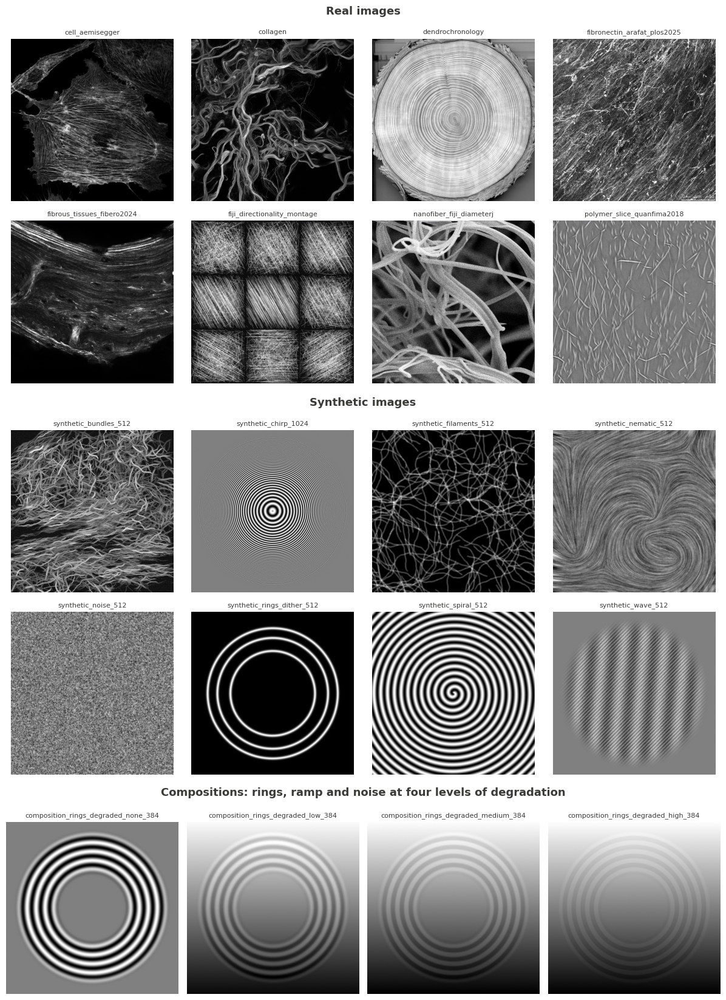</a>

The [test-images](https://github.com/Biomedical-Imaging-Group/OrientationJ/tree/master/test-images) folder of the repository holds the 20 source images in `images/`, the 20 binary masks in `masks/`, and in `code/` what builds them: [synthetic_images_2D.ipynb](https://github.com/Biomedical-Imaging-Group/OrientationJ/blob/master/test-images/code/synthetic_images_2D.ipynb) generates the synthetic images and the compositions, [masks_2D.ipynb](https://github.com/Biomedical-Imaging-Group/OrientationJ/blob/master/test-images/code/masks_2D.ipynb) the masks (the gradient energy above 0.5% of its maximum, or the analytic annulus for the compositions), and [macro-maps.ijm](https://github.com/Biomedical-Imaging-Group/OrientationJ/blob/master/test-images/code/macro-maps.ijm) computes with the plugin the feature maps of every image (orientation, coherency, energy, 32-bit TIFF). Below, every image comes with an overview panel: original, mask, orientation, coherency, energy, color survey, masked distribution and vector field, all computed at the plugin defaults (cubic-spline gradient, σ = 1). The images are listed in the order of the montage; click a panel for full size.

## Real images

### cell_aemisegger 

728 × 728, uint8, values in [0, 252] — real: fluorescence cell, actin fibers.

Download: [image](https://raw.githubusercontent.com/Biomedical-Imaging-Group/OrientationJ/master/test-images/images/cell_aemisegger.tif) · [mask](https://raw.githubusercontent.com/Biomedical-Imaging-Group/OrientationJ/master/test-images/masks/cell_aemisegger.tif)

[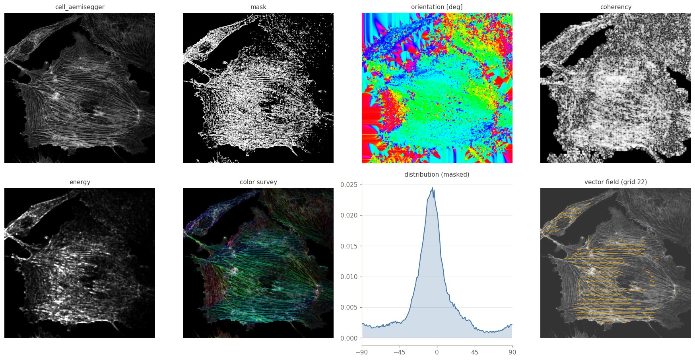](assets/test-images/cell_aemisegger.jpg)

### collagen 

512 × 512, uint8, values in [2, 255] — real: collagen fibers.

Download: [image](https://raw.githubusercontent.com/Biomedical-Imaging-Group/OrientationJ/master/test-images/images/collagen.tif) · [mask](https://raw.githubusercontent.com/Biomedical-Imaging-Group/OrientationJ/master/test-images/masks/collagen.tif)

[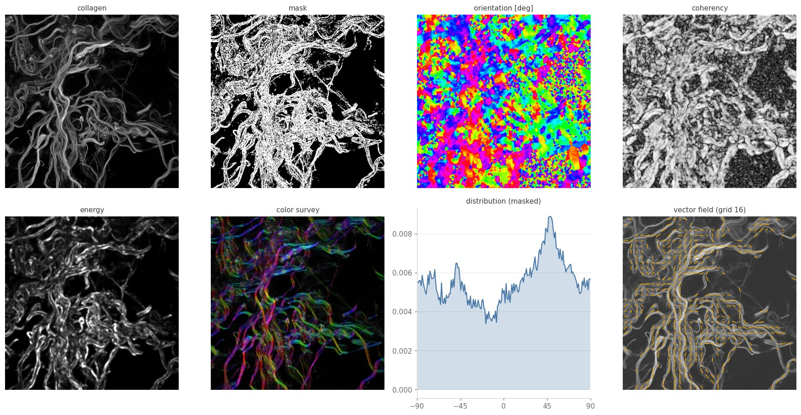](assets/test-images/collagen.jpg)

### dendrochronology 

512 × 512, uint8, values in [0, 255] — real: wood section, growth rings.

Download: [image](https://raw.githubusercontent.com/Biomedical-Imaging-Group/OrientationJ/master/test-images/images/dendrochronology.tif) · [mask](https://raw.githubusercontent.com/Biomedical-Imaging-Group/OrientationJ/master/test-images/masks/dendrochronology.tif)

[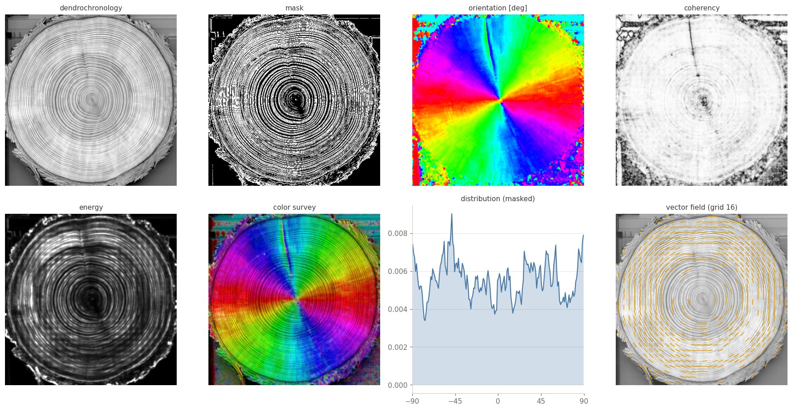](assets/test-images/dendrochronology.jpg)

### fibronectin_arafat_plos2025 

1024 × 1024, uint8, values in [0, 255] — real: fibronectin network (Arafat et al., PLOS ONE 2025).

Download: [image](https://raw.githubusercontent.com/Biomedical-Imaging-Group/OrientationJ/master/test-images/images/fibronectin_arafat_plos2025.tif) · [mask](https://raw.githubusercontent.com/Biomedical-Imaging-Group/OrientationJ/master/test-images/masks/fibronectin_arafat_plos2025.tif)

M. Arafat et al., *PLOS ONE* (2025), [doi:10.1371/journal.pone.0320006](https://doi.org/10.1371/journal.pone.0320006).

[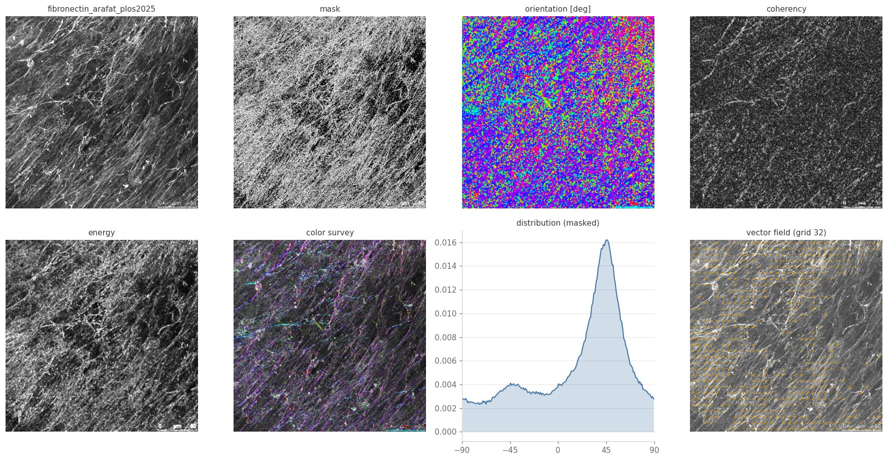](assets/test-images/fibronectin_arafat_plos2025.jpg)

### fibrous_tissues_fibero2024 

2048 × 2048, uint16, values in [87, 4094] — real: fibrous tissue (FiberO, 2024).

Download: [image](https://raw.githubusercontent.com/Biomedical-Imaging-Group/OrientationJ/master/test-images/images/fibrous_tissues_fibero2024.tif) · [mask](https://raw.githubusercontent.com/Biomedical-Imaging-Group/OrientationJ/master/test-images/masks/fibrous_tissues_fibero2024.tif)

FiberO dataset (2024), [doi:10.3389/fbioe.2024.1497837](https://doi.org/10.3389/fbioe.2024.1497837).

[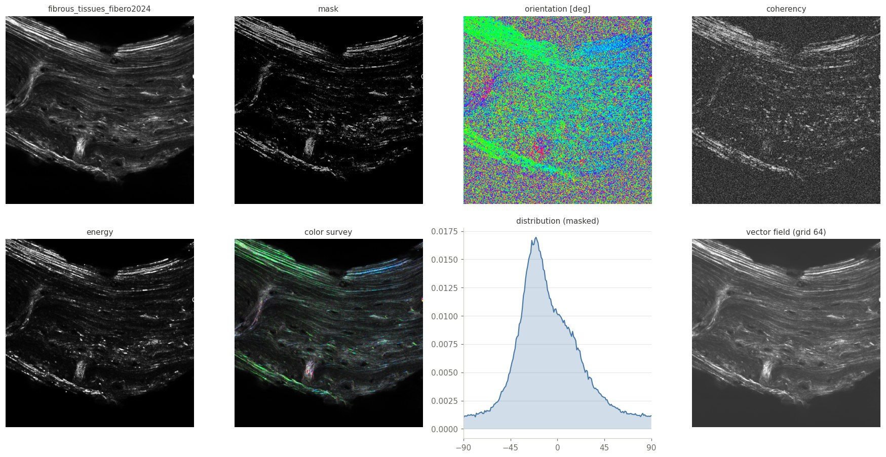](assets/test-images/fibrous_tissues_fibero2024.jpg)

### fiji_directionality_montage 

1536 × 1536, uint16, values in [3089, 65535] — real: montage from the Fiji Directionality documentation.

Download: [image](https://raw.githubusercontent.com/Biomedical-Imaging-Group/OrientationJ/master/test-images/images/fiji_directionality_montage.tif) · [mask](https://raw.githubusercontent.com/Biomedical-Imaging-Group/OrientationJ/master/test-images/masks/fiji_directionality_montage.tif)

Montage from the documentation of the Fiji [Directionality](https://imagej.net/plugins/directionality) plugin.

[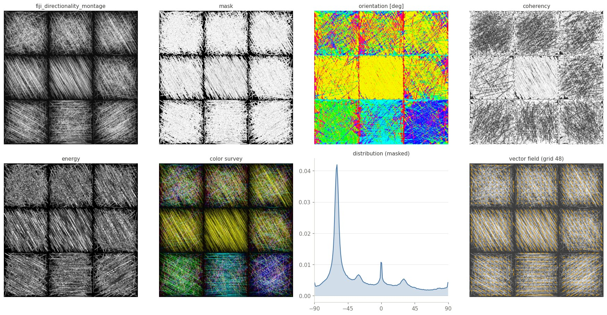](assets/test-images/fiji_directionality_montage.jpg)

### nanofiber_fiji_diameterj 

512 × 512, uint8, values in [0, 255] — real: SEM nanofibers (DiameterJ sample).

Download: [image](https://raw.githubusercontent.com/Biomedical-Imaging-Group/OrientationJ/master/test-images/images/nanofiber_fiji_diameterj.tif) · [mask](https://raw.githubusercontent.com/Biomedical-Imaging-Group/OrientationJ/master/test-images/masks/nanofiber_fiji_diameterj.tif)

DiameterJ sample — S. A. Hotaling et al., *Data in Brief* (2015), [doi:10.1016/j.dib.2015.07.012](https://doi.org/10.1016/j.dib.2015.07.012).

[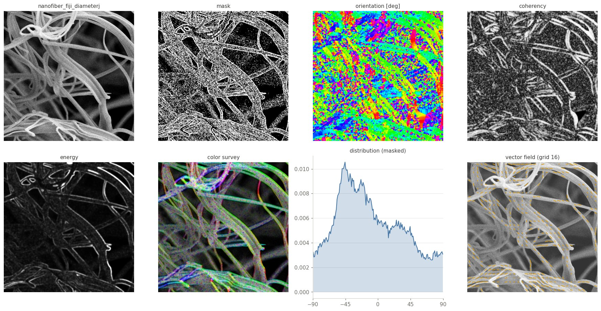](assets/test-images/nanofiber_fiji_diameterj.jpg)

### polymer_slice_quanfima2018 

600 × 600, float32, values in [−0.0029, 0.0030] — real: polymer slice (quanfima, 2018).

Download: [image](https://raw.githubusercontent.com/Biomedical-Imaging-Group/OrientationJ/master/test-images/images/polymer_slice_quanfima2018.tif) · [mask](https://raw.githubusercontent.com/Biomedical-Imaging-Group/OrientationJ/master/test-images/masks/polymer_slice_quanfima2018.tif)

[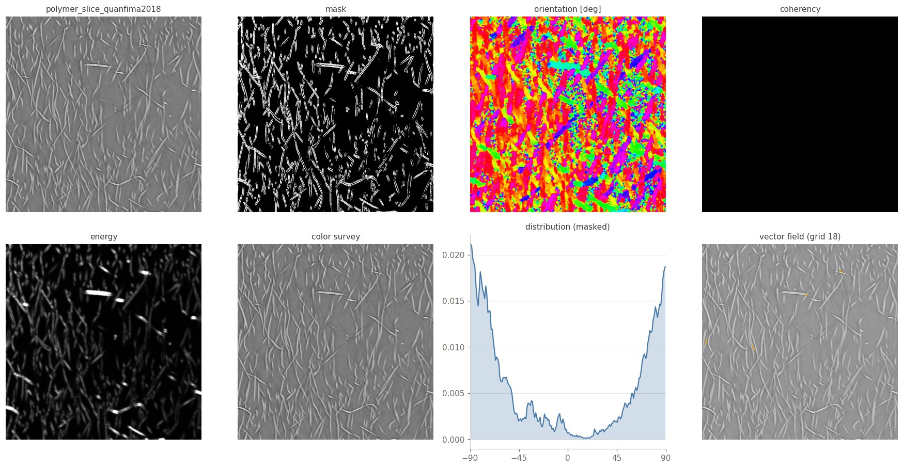](assets/test-images/polymer_slice_quanfima2018.jpg)

## Synthetic images

### synthetic_bundles_512 

512 × 512, float32, values in [0, 1] — synthetic: matted web of 4000 wavy fibers rendered as lit tubes of radius 0.1–3 px, knitted by branching, with three elliptical patches that pull the fibers into bundles.

Download: [image](https://raw.githubusercontent.com/Biomedical-Imaging-Group/OrientationJ/master/test-images/images/synthetic_bundles_512.tif) · [mask](https://raw.githubusercontent.com/Biomedical-Imaging-Group/OrientationJ/master/test-images/masks/synthetic_bundles_512.tif)

[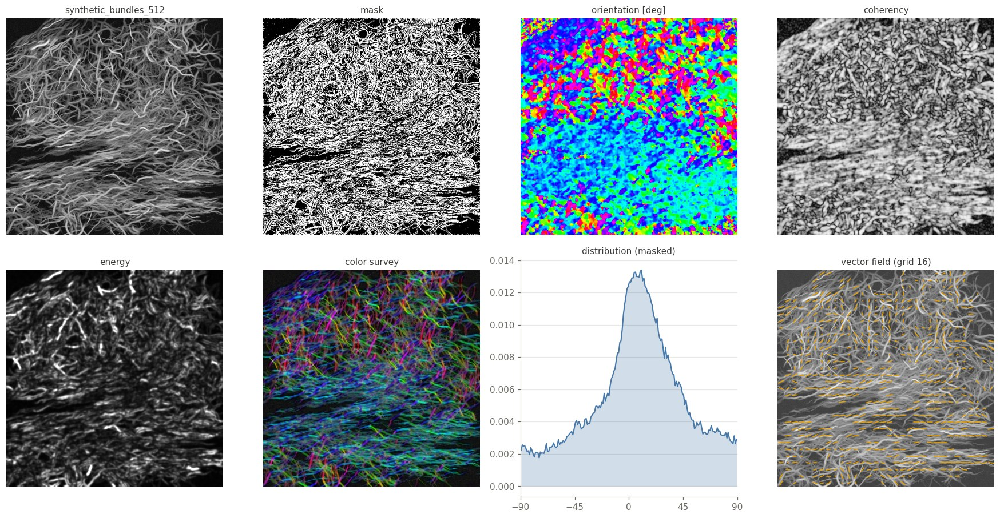](assets/test-images/synthetic_bundles_512.jpg)

### synthetic_chirp_1024 

1024 × 1024, float32, values in [0, 1] — synthetic: radial chirp with a frequency sweep; the tangential ground-truth orientation is known at every pixel.

Download: [image](https://raw.githubusercontent.com/Biomedical-Imaging-Group/OrientationJ/master/test-images/images/synthetic_chirp_1024.tif) · [mask](https://raw.githubusercontent.com/Biomedical-Imaging-Group/OrientationJ/master/test-images/masks/synthetic_chirp_1024.tif)

[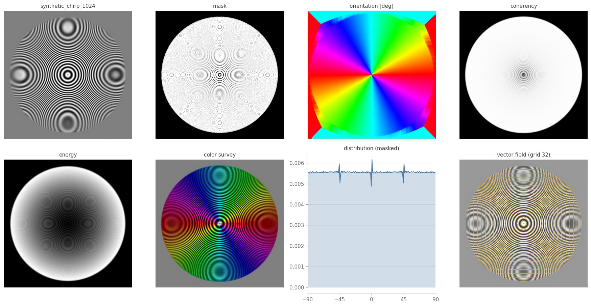](assets/test-images/synthetic_chirp_1024.jpg)

### synthetic_filaments_512 

512 × 512, float32, values in [0, 1] — synthetic: random curved filaments.

Download: [image](https://raw.githubusercontent.com/Biomedical-Imaging-Group/OrientationJ/master/test-images/images/synthetic_filaments_512.tif) · [mask](https://raw.githubusercontent.com/Biomedical-Imaging-Group/OrientationJ/master/test-images/masks/synthetic_filaments_512.tif)

[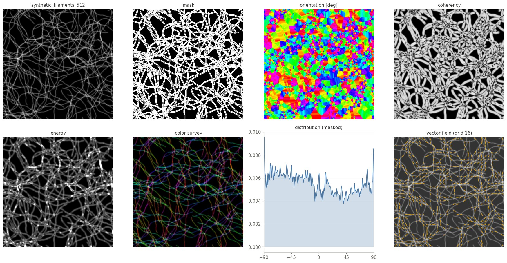](assets/test-images/synthetic_filaments_512.jpg)

### synthetic_nematic_512 

512 × 512, float32, values in [0, 1] — synthetic: nematic-like texture with a dominant direction.

Download: [image](https://raw.githubusercontent.com/Biomedical-Imaging-Group/OrientationJ/master/test-images/images/synthetic_nematic_512.tif) · [mask](https://raw.githubusercontent.com/Biomedical-Imaging-Group/OrientationJ/master/test-images/masks/synthetic_nematic_512.tif)

Pattern inspired by active nematics — A. Doostmohammadi, J. Ignés-Mullol, J. M. Yeomans, F. Sagués, *Active nematics*, Nature Communications 9:3246 (2018), [doi:10.1038/s41467-018-05666-8](https://doi.org/10.1038/s41467-018-05666-8).

[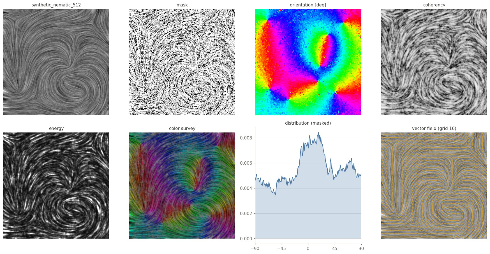](assets/test-images/synthetic_nematic_512.jpg)

### synthetic_noise_512 

512 × 512, float32, values in [0, 1] — synthetic: isotropic noise; any measured anisotropy is bias.

Download: [image](https://raw.githubusercontent.com/Biomedical-Imaging-Group/OrientationJ/master/test-images/images/synthetic_noise_512.tif) · [mask](https://raw.githubusercontent.com/Biomedical-Imaging-Group/OrientationJ/master/test-images/masks/synthetic_noise_512.tif)

[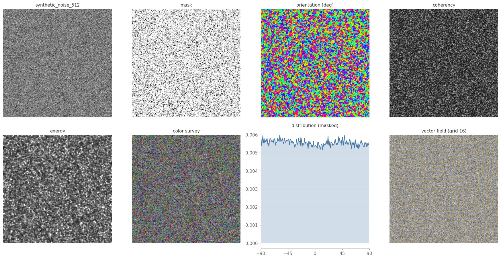](assets/test-images/synthetic_noise_512.jpg)

### synthetic_rings_dither_512 

512 × 512, float32, values in [0, 1] — synthetic: thin concentric rings with a small dither (σ = 10⁻⁴) that avoids degenerate-tensor spikes; exact tangential truth.

Download: [image](https://raw.githubusercontent.com/Biomedical-Imaging-Group/OrientationJ/master/test-images/images/synthetic_rings_dither_512.tif) · [mask](https://raw.githubusercontent.com/Biomedical-Imaging-Group/OrientationJ/master/test-images/masks/synthetic_rings_dither_512.tif)

[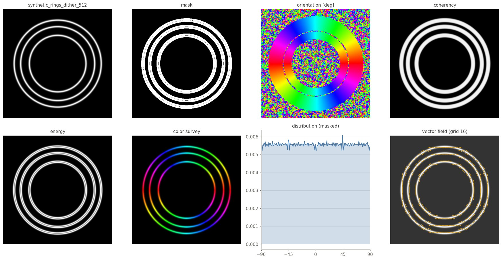](assets/test-images/synthetic_rings_dither_512.jpg)

### synthetic_spiral_512 

512 × 512, float32, values in [0, 1] — synthetic: spiral.

Download: [image](https://raw.githubusercontent.com/Biomedical-Imaging-Group/OrientationJ/master/test-images/images/synthetic_spiral_512.tif) · [mask](https://raw.githubusercontent.com/Biomedical-Imaging-Group/OrientationJ/master/test-images/masks/synthetic_spiral_512.tif)

[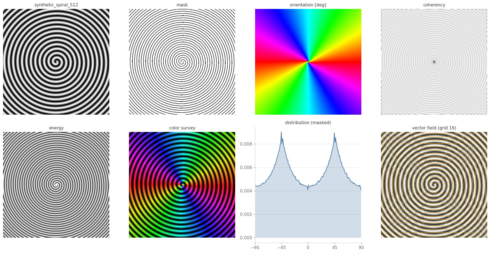](assets/test-images/synthetic_spiral_512.jpg)

### synthetic_wave_512 

512 × 512, float32, values in [0, 1] — synthetic: three waves with fringes at exactly 5°, 45° and 85° and periods of 2, 8 and 64 px, plus uniform noise, in a circular Tukey window of 480 px.

Download: [image](https://raw.githubusercontent.com/Biomedical-Imaging-Group/OrientationJ/master/test-images/images/synthetic_wave_512.tif) · [mask](https://raw.githubusercontent.com/Biomedical-Imaging-Group/OrientationJ/master/test-images/masks/synthetic_wave_512.tif)

[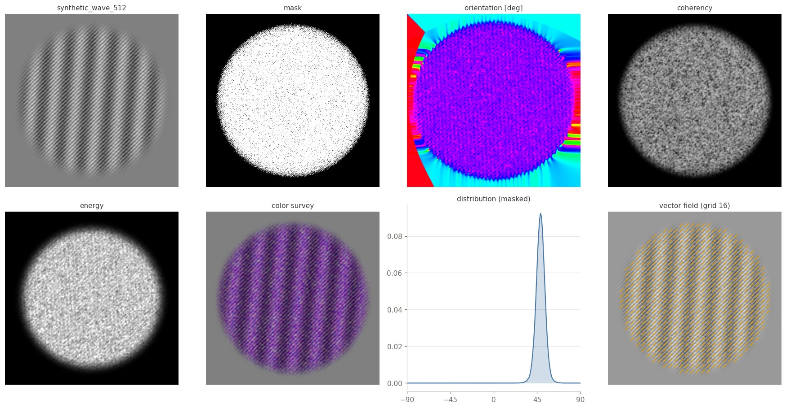](assets/test-images/synthetic_wave_512.jpg)

## Compositions: rings, ramp and noise at four levels of degradation

### composition_rings_degraded_none_384 

384 × 384, float32, values in [0, 1] — composition: clean sine rings of period 20 px on an annulus of radii 70–175 px with smooth edges; no saturation, no ramp, no noise: the reference level of the structure vs nematic assessment. Exact tangential truth; the mask is the annulus.

Download: [image](https://raw.githubusercontent.com/Biomedical-Imaging-Group/OrientationJ/master/test-images/images/composition_rings_degraded_none_384.tif) · [mask](https://raw.githubusercontent.com/Biomedical-Imaging-Group/OrientationJ/master/test-images/masks/composition_rings_degraded_none_384.tif)

[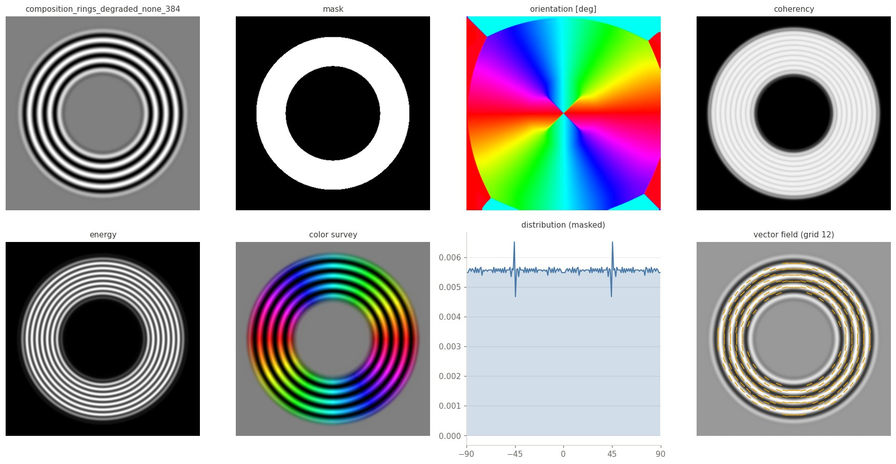](assets/test-images/composition_rings_degraded_none_384.jpg)

### composition_rings_degraded_low_384 

384 × 384, float32, values in [0, 1] — composition: the same rings, 40% of the pixels saturated (clipped), on a vertical ramp of slope 0.01 per px, plus Gaussian noise of σ = 0.005; the low level of the structure vs nematic assessment.

Download: [image](https://raw.githubusercontent.com/Biomedical-Imaging-Group/OrientationJ/master/test-images/images/composition_rings_degraded_low_384.tif) · [mask](https://raw.githubusercontent.com/Biomedical-Imaging-Group/OrientationJ/master/test-images/masks/composition_rings_degraded_low_384.tif)

[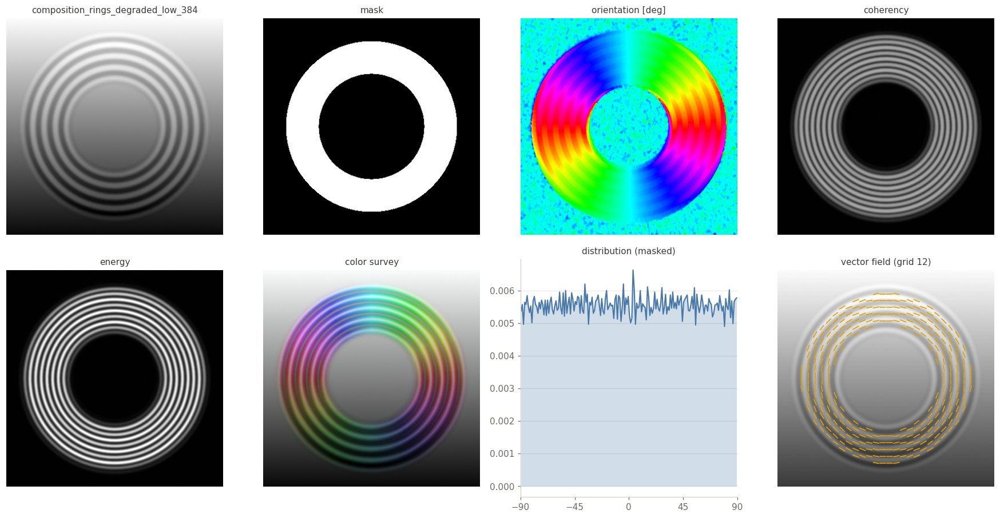](assets/test-images/composition_rings_degraded_low_384.jpg)

### composition_rings_degraded_medium_384 

384 × 384, float32, values in [0, 1] — composition: the same rings, 60% of the pixels saturated, ramp of slope 0.02 per px, Gaussian noise of σ = 0.015; the medium level of the structure vs nematic assessment.

Download: [image](https://raw.githubusercontent.com/Biomedical-Imaging-Group/OrientationJ/master/test-images/images/composition_rings_degraded_medium_384.tif) · [mask](https://raw.githubusercontent.com/Biomedical-Imaging-Group/OrientationJ/master/test-images/masks/composition_rings_degraded_medium_384.tif)

[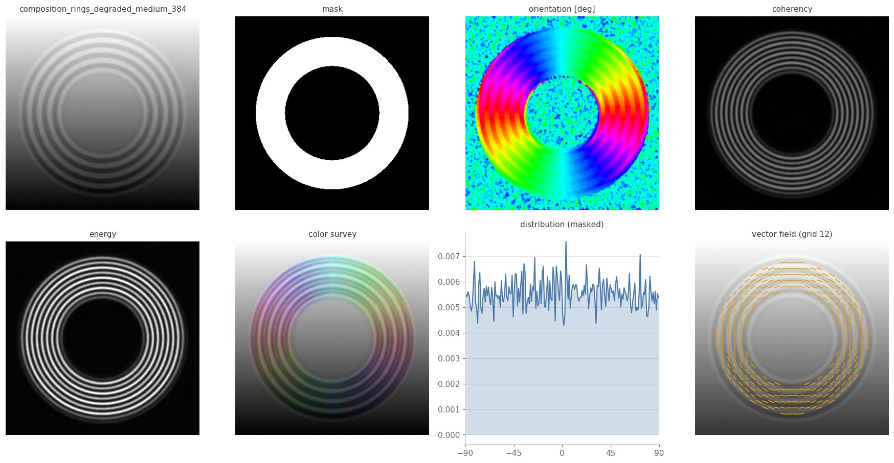](assets/test-images/composition_rings_degraded_medium_384.jpg)

### composition_rings_degraded_high_384 

384 × 384, float32, values in [0, 1] — composition: the same rings, 80% of the pixels saturated, ramp of slope 0.05 per px, Gaussian noise of σ = 0.025; the high level of the structure vs nematic assessment.

Download: [image](https://raw.githubusercontent.com/Biomedical-Imaging-Group/OrientationJ/master/test-images/images/composition_rings_degraded_high_384.tif) · [mask](https://raw.githubusercontent.com/Biomedical-Imaging-Group/OrientationJ/master/test-images/masks/composition_rings_degraded_high_384.tif)

[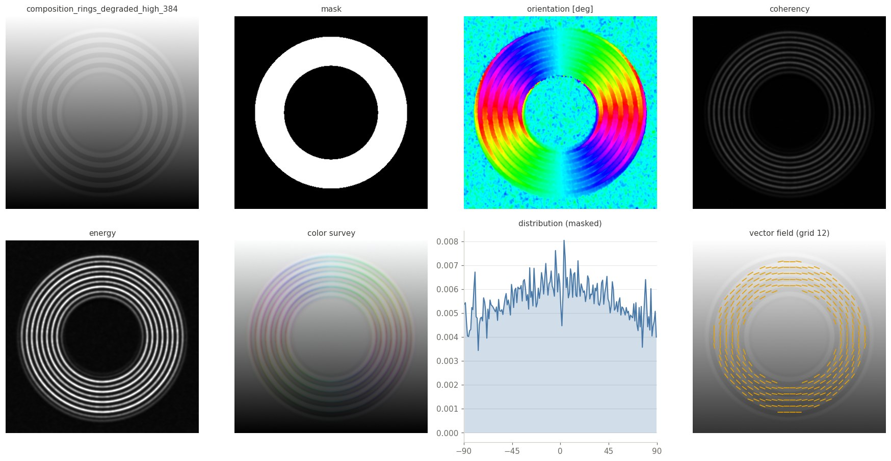](assets/test-images/composition_rings_degraded_high_384.jpg)
